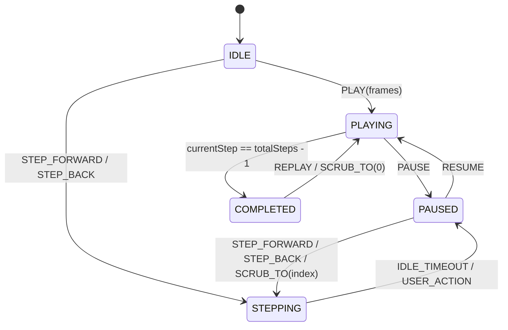
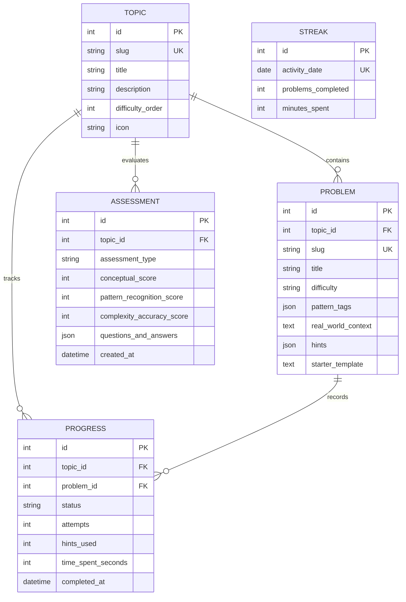

# AlgoScope — Technical Architecture Document

> **Status:** Final / Binding  
> **Version:** 1.0  
> **Date:** 2026-10-11  
> **Target Audience:** Full-stack Developer (Owner), Agent Implementers  
> **Companion Document:** [docs/prd.md](file:///c:/Users/malay/algoscope/docs/prd.md)

---

## 1. System Paradigm & Boundary Rules

AlgoScope is built as an **Event-Sourced Batch Execution System** across a decoupled full-stack monorepo:

1. **Separation of Concerns:**
   - **Backend (FastAPI / Python 3.12+):** Algorithmic computation engine, execution tracing generator, progress persistence, and test verification runner.
   - **Frontend (Next.js 14+ / TypeScript):** Visual presentation, user interaction, playback state machine, animation canvas adapters, and personal dashboard.
2. **Execution Boundary:** Algorithms are executed on the backend via deterministic batch runs that return an immutable sequence of step frames (`Frame[]`). The frontend is a pure consumer and renderer of these timeline events, decoupling algorithm execution from visualization framerates.
3. **Owner Learning Ownership Boundary:**
   - **Python:** The owner writes algorithm logic, `yield Frame(...)` instrumentations, domain services, and pytest suites.
   - **TypeScript:** The owner implements `Frame` reducers, timeline playback hooks, canvas render adapters (translating frames to SVG/Canvas/React Flow/Framer Motion), and custom UI interaction logic.

---

## 2. Shared Protocol: Frame Schema Contract

Every algorithm execution endpoint (`POST /api/dsa/{topic}/{problem}/execute`) adheres to a strict shared contract between FastAPI (Pydantic) and Next.js (TypeScript / Zod).

### 2.1 Backend Contract (Python / Pydantic)

```python
# backend/app/schemas/frame.py
from typing import Any, Dict, List, Optional
from pydantic import BaseModel, Field

class FrameHighlight(BaseModel):
    indices: List[int] = Field(default_factory=list, description="Target array indices or node IDs")
    color: str = Field(default="primary", description="primary | secondary | success | danger | warning")
    label: Optional[str] = Field(default=None, description="Optional callout e.g. 'left pointer'")

class Frame(BaseModel):
    step: int = Field(..., description="0-indexed sequence counter")
    phase: str = Field(..., description="e.g. 'initialize', 'compare', 'swap', 'shrink_window', 'complete'")
    state: Dict[str, Any] = Field(..., description="Snapshot of the data structure (array, tree, grid, etc.)")
    pointers: Dict[str, Any] = Field(default_factory=dict, description="Active pointer/cursor keys e.g. {'left': 0, 'right': 3}")
    highlights: List[FrameHighlight] = Field(default_factory=list, description="Visual focus elements")
    explanation: str = Field(..., description="Human-readable log of what occurred at this step")

class AlgorithmExecutionResponse(BaseModel):
    success: bool
    total_steps: int
    frames: List[Frame]
    metrics: Dict[str, Any] = Field(
        default_factory=dict,
        description="e.g. {'comparisons': 12, 'swaps': 4, 'time_complexity': 'O(N)', 'space_complexity': 'O(1)'}"
    )
    error: Optional[str] = None
```

### 2.2 Frontend Contract (TypeScript)

```typescript
// frontend/types/dsa.ts
export type HighlightColor =
  "primary" | "secondary" | "success" | "danger" | "warning";

export interface FrameHighlight {
  indices: (number | string)[];
  color: HighlightColor;
  label?: string;
}

export interface Frame<TState = Record<string, unknown>> {
  step: number;
  phase: string;
  state: TState;
  pointers: Record<string, number | string | null>;
  highlights: FrameHighlight[];
  explanation: string;
}

export interface AlgorithmExecutionResponse<TState = Record<string, unknown>> {
  success: boolean;
  total_steps: number;
  frames: Frame<TState>[];
  metrics: {
    comparisons?: number;
    swaps?: number;
    time_complexity?: string;
    space_complexity?: string;
    [key: string]: unknown;
  };
  error?: string;
}
```

---

## 3. Playback Engine State Machine

The frontend provides a deterministic timeline playback engine encapsulated in a custom React hook `useAlgorithmPlayback`.



### State Machine Specification (`useAlgorithmPlayback`)

- **State Vector:**
  - `status: 'idle' | 'playing' | 'paused' | 'completed'`
  - `currentIndex: number` (0 to `frames.length - 1`)
  - `speedMs: number` (e.g., 200ms, 500ms, 1000ms per frame)
  - `isPlaying: boolean`
- **Actions Dispatched:**
  - `play()`: Starts requestAnimationFrame / interval timer incrementing `currentIndex`.
  - `pause()`: Freezes timer, keeps `currentIndex`.
  - `stepForward()`: Advances `currentIndex = Math.min(currentIndex + 1, total - 1)`.
  - `stepBackward()`: Moves `currentIndex = Math.max(currentIndex - 1, 0)`.
  - `scrubTo(index)`: Directly sets `currentIndex` for instant slider scrubbing.
  - `setSpeed(speedMs)`: Dynamically changes tick interval.
  - `reset()`: Resets `currentIndex = 0`, status to `'idle'`.

---

## 4. Database Schema & Persistence (SQLite + SQLAlchemy)

AlgoScope utilizes SQLite with SQLAlchemy 2.0+ for file-based zero-configuration persistence.



---

## 5. Monorepo Directory Topology

```
algoscope/
├── package.json                    # Monorepo scripts & lint orchestration
├── .gitignore
├── docs/                           # Living product & architectural docs
│   ├── prd.md
│   ├── architecture.md             # This document
│   └── topic-plans/
├── frontend/                       # Next.js 14 App Router + TypeScript
│   ├── package.json
│   ├── tsconfig.json
│   ├── tailwind.config.ts
│   ├── components.json             # shadcn/ui configuration
│   ├── app/
│   │   ├── layout.tsx              # Root shell with Nav & Providers
│   │   ├── page.tsx                # Topic Hub Landing
│   │   ├── dashboard/page.tsx      # Analytics & Streak Dashboard
│   │   ├── topics/[topicSlug]/
│   │   │   ├── page.tsx            # Topic Overview & Inspiration
│   │   │   ├── demo/page.tsx       # Interactive Visualizer
│   │   │   ├── project/page.tsx    # Mini-App page
│   │   │   ├── patterns/page.tsx   # Pattern Cheat Sheet
│   │   │   └── problems/[problemSlug]/page.tsx
│   │   └── api/auth/[...nextauth]/route.ts
│   ├── components/
│   │   ├── ui/                     # shadcn primitives (Button, Slider, Card, etc.)
│   │   ├── layout/                 # Header, Sidebar, TopicNav
│   │   ├── playback/               # TimelineScrubber, SpeedControl, StepControls
│   │   ├── visualizations/
│   │   │   ├── linear/             # ArrayBar, WindowBox, PointerCursor
│   │   │   └── graph/              # ReactFlowGraph, NodeWave, EdgeWeight
│   │   └── mini-apps/              # Mini-App UI shells
│   ├── hooks/
│   │   ├── useAlgorithmPlayback.ts # [OWNER IMPLEMENTS] Playback hook
│   │   └── useTopicProgress.ts
│   ├── lib/
│   │   ├── apiClient.ts            # Fetch wrapper for FastAPI
│   │   └── utils.ts
│   └── types/
│       ├── dsa.ts                  # Shared Frame and Execution types
│       └── models.ts               # API entities
├── backend/                        # FastAPI + Python 3.12 (uv managed)
│   ├── pyproject.toml
│   ├── app/
│   │   ├── main.py                 # FastAPI application factory & CORS
│   │   ├── core/
│   │   │   ├── config.py           # Settings, DB URL, Auth secrets
│   │   │   └── database.py         # SQLAlchemy engine & sessionmaker
│   │   ├── models/                 # SQLAlchemy DB models
│   │   │   ├── topic.py
│   │   │   ├── problem.py
│   │   │   ├── progress.py
│   │   │   ├── assessment.py
│   │   │   └── streak.py
│   │   ├── schemas/                # Pydantic input/output schemas
│   │   │   ├── frame.py            # Execution and frame schemas
│   │   │   ├── topic.py
│   │   │   └── assessment.py
│   │   ├── api/
│   │   │   ├── topics.py
│   │   │   ├── problems.py
│   │   │   ├── dsa.py              # DSA execution endpoints
│   │   │   ├── assessments.py
│   │   │   └── progress.py
│   │   ├── services/               # Execution orchestration & runners
│   │   └── dsa/                    # [OWNER IMPLEMENTS] DSA Solutions & Generators
│   │       ├── arrays/
│   │       │   ├── sliding_window.py
│   │       │   └── two_pointers.py
│   │       └── graphs/
│   │           ├── bfs_dfs.py
│   │           └── dijkstra.py
│   └── tests/                      # [OWNER IMPLEMENTS] Pytest suites
│       ├── conftest.py
│       └── dsa/
│           ├── test_arrays.py
│           └── test_graphs.py
```

---

## 6. Architectural Invariants (AD Summary)

- **AD-1 (Frame Contract Invariant):** All visualization endpoints return the standard `AlgorithmExecutionResponse` with `Frame[]`. No endpoint may return proprietary unstructured animation formats.
- **AD-2 (Playback Engine Invariant):** The visualization state machine is pure, deterministic, and frame-indexed. Scrubbing to index $k$ immediately yields the state of step $k$ without side effects.
- **AD-3 (Dual-Stack Learning Invariant):** Scaffolding provides complete type signatures and test harnesses; the owner implements the core logic in both Python (backend generators & tests) and TypeScript (frontend adapters & state reducers).
- **AD-4 (Persistence Invariant):** All progress, attempts, and assessment answers persist locally in SQLite, guaranteeing that learning history is preserved offline and across restarts.
